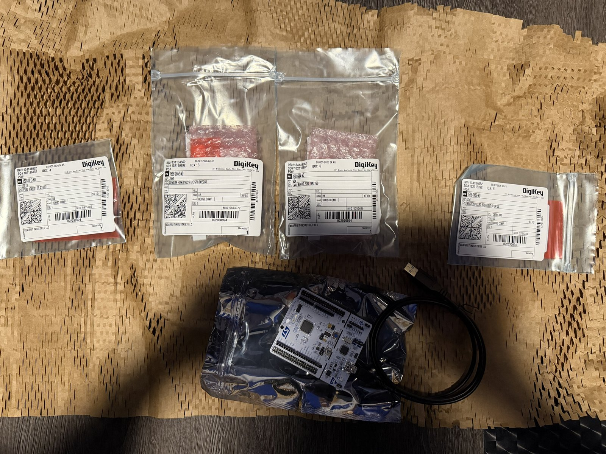

# stm32-data-logger

**Bare-metal firmware for an environmental and power data logger on STM32.**

Reads temperature, humidity, pressure and current from I2C sensors, timestamps each reading with a real-time clock, and writes it to a microSD card as CSV. Written in C, configuring the hardware through registers rather than generated code.

> 🚧 **Status:** Parts arrived October 2026. Firmware in progress. See the [roadmap](#roadmap).



## Why I'm building it

I studied Electrical Engineering Technology (Control) before moving into software. This project brings the two together: I want to understand exactly what happens between a register write and a byte landing on an SD card, without a framework hiding it.

## Hardware

| Part | Role | Interface |
| --- | --- | --- |
| [NUCLEO-L476RG](https://www.st.com/en/evaluation-tools/nucleo-l476rg.html) | STM32L476 (Arm Cortex-M4, 80 MHz) dev board with on-board ST-LINK | — |
| Adafruit BME280 | Temperature, humidity, pressure | I2C |
| Adafruit INA219 | Current, bus voltage and power | I2C |
| Adafruit DS3231 | Precision real-time clock for timestamps | I2C |
| Adafruit microSD breakout | Log storage | SPI |

## Planned design

```
 BME280 ─┐
 INA219 ─┼── I2C1 ──┐
 DS3231 ─┘          │
                 STM32L476 ── USART2 ──> debug console (via ST-LINK USB)
 microSD ── SPI1 ───┘
```

- **One shared I2C bus** for the three sensors, each at its own address
- **Timer-driven sampling** at a fixed interval, with the main loop sleeping between samples
- **CSV log file** on a FAT-formatted SD card: `timestamp, temp_c, humidity_pct, pressure_hpa, current_ma, bus_v`
- **UART debug output** over the Nucleo's USB connection

Pin assignments and a wiring photo will go here once the breadboard build is done.

## Roadmap

- [ ] Toolchain: `arm-none-eabi-gcc`, linker script, startup code, flashing with OpenOCD or STM32CubeProgrammer
- [ ] Blink the on-board LED by writing GPIO registers directly
- [ ] System clock configuration
- [ ] UART driver for debug output
- [ ] I2C driver, then read the DS3231 time
- [ ] BME280 driver with the datasheet's compensation formulas
- [ ] INA219 driver: calibration register, current and voltage reads
- [ ] SPI driver and SD card initialisation
- [ ] FAT file writes and CSV logging
- [ ] Timer-driven sampling and low-power sleep between readings
- [ ] Wiring diagram, photos, and a sample log file

## Build

Build and flash instructions will be added with the first firmware milestone.

## References

- [STM32L4 reference manual (RM0351)](https://www.st.com/resource/en/reference_manual/rm0351-stm32l47xxx-stm32l48xxx-stm32l49xxx-and-stm32l4axxx-advanced-armbased-32bit-mcus-stmicroelectronics.pdf)
- [NUCLEO-L476RG user manual (UM1724)](https://www.st.com/resource/en/user_manual/um1724-stm32-nucleo64-boards-mb1136-stmicroelectronics.pdf)
- Sensor datasheets: BME280 (Bosch), INA219 (TI), DS3231 (Analog Devices)

## Author

**Ayub Ali** · [GitHub](https://github.com/ayubmja2) · [LinkedIn](https://www.linkedin.com/in/ayubmja/)
